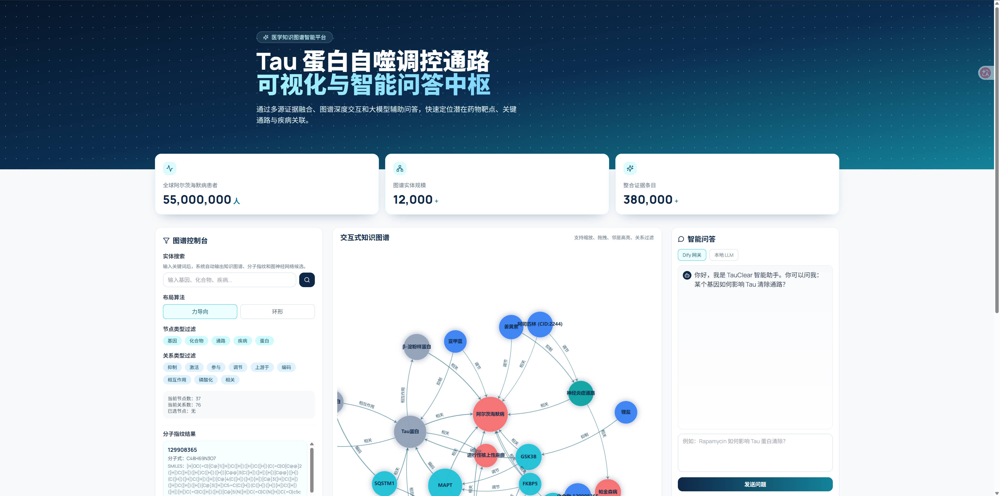
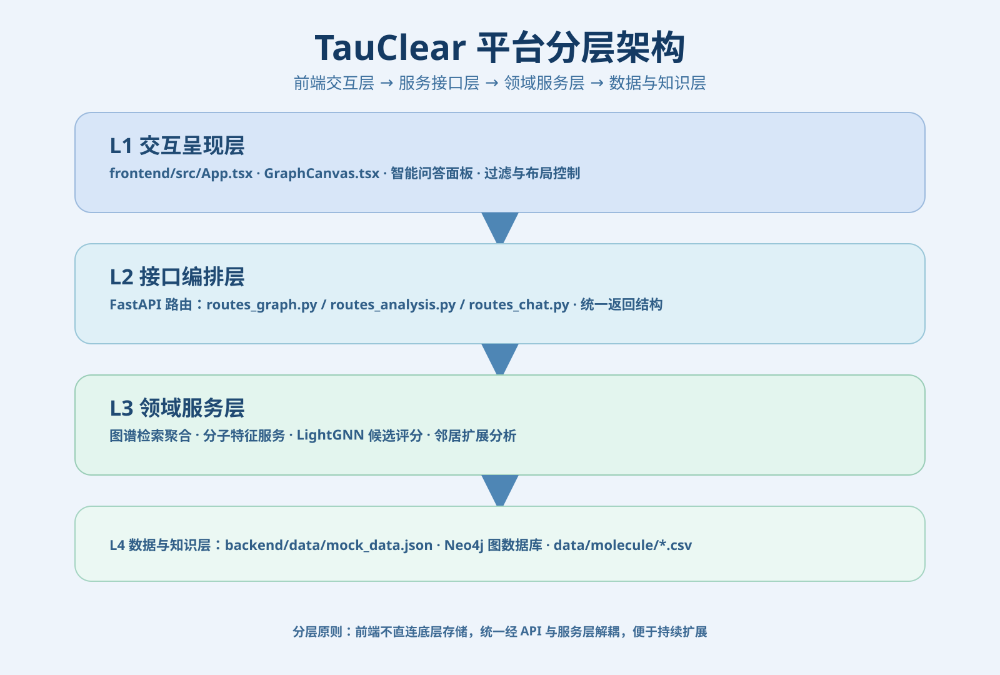
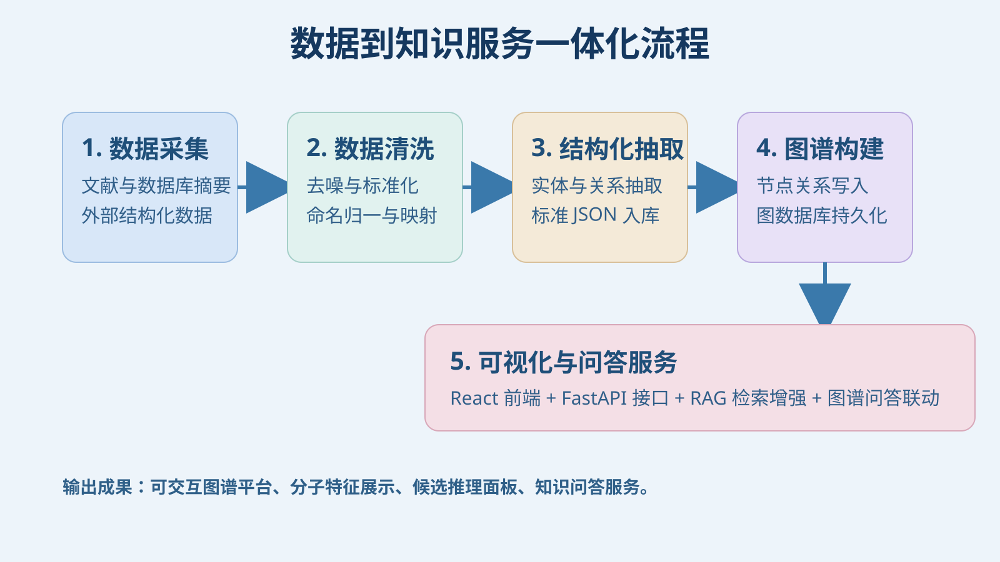
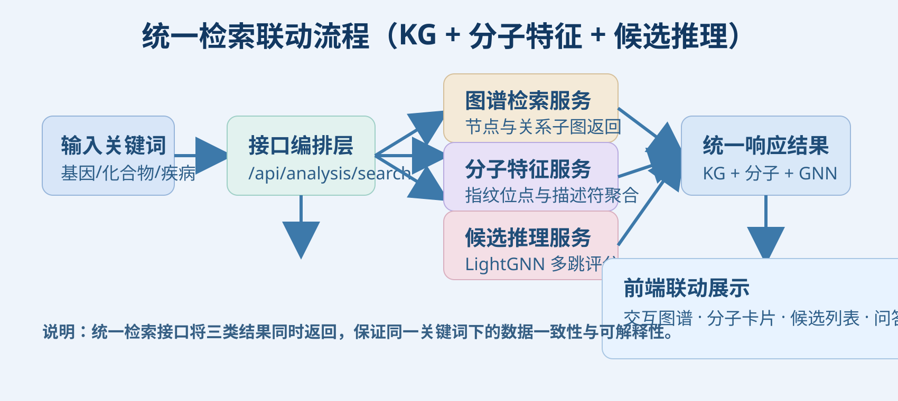
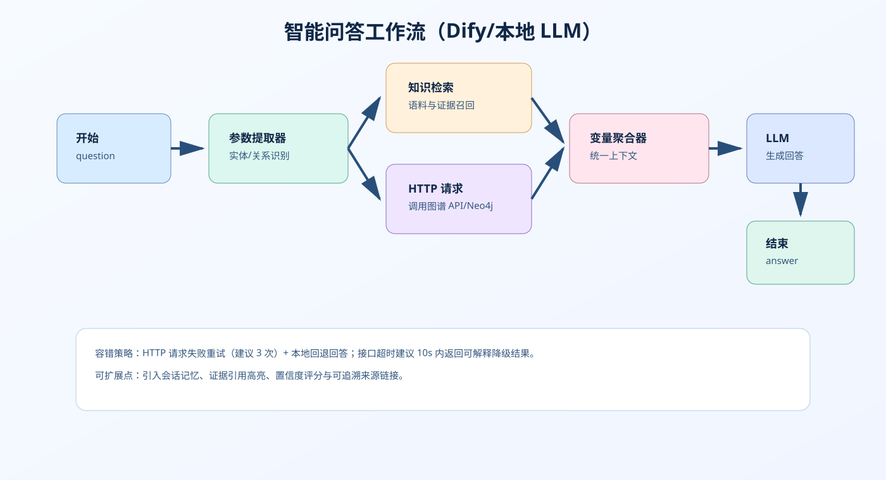
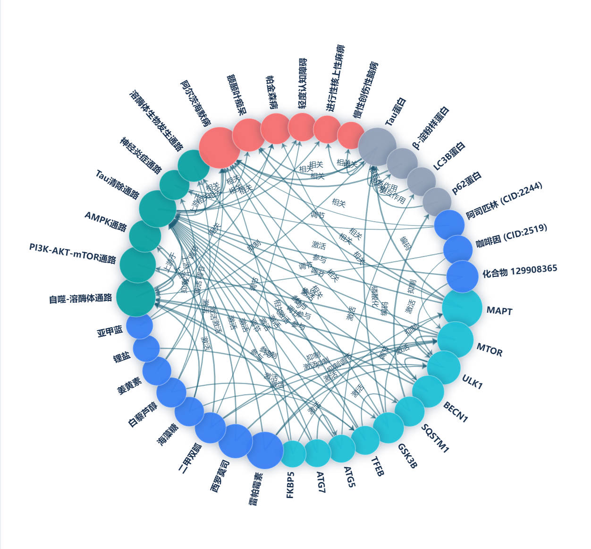

# 基于 TauClear 的 RAG 与 KG 集成 Tau 自噬通路智能筛选系统

## 一、系统简介

本系统面向 Tau 蛋白自噬调控研究与应用场景，整合知识图谱、分子特征和问答服务，形成可直接部署使用的一体化平台。用户通过统一检索入口即可联动查看实体关系网络、化合物分子指纹与描述符、候选结果评分，并在同一界面完成问题咨询与结果追踪。

## 二、产品界面



## 三、平台分层架构

系统采用四层分离架构：交互呈现层、接口编排层、领域服务层、数据与知识层。



### L1 交互呈现层

- 图谱交互与布局控制
- 节点/关系筛选
- 分子特征卡片展示
- 候选结果榜单展示
- 智能问答面板

### L2 接口编排层

- 提供统一 REST API
- 统一参数校验与结果结构
- 承载图谱、分子、候选与问答的请求编排

### L3 领域服务层

- 图谱检索聚合服务
- 分子特征服务（Morgan、MACCS、描述符）
- 候选推理服务（LightGNN 评分）
- 邻域扩展与关联分析服务

### L4 数据与知识层

- 图谱数据（JSON / Neo4j）
- 分子描述符与分子指纹数据
- 构图脚本与数据导入逻辑

## 四、业务流程图

### 1）数据到知识服务流水线（优化版）



### 2）统一检索联动流程（优化版）



### 3）智能问答工作流



## 五、蛋白知识图谱展示



## 六、核心能力

1. 统一检索联动输出
   - 同时返回图谱子图、分子特征、候选结果。

2. 分子特征可视化
   - 支持 Morgan 位指纹、MACCS 位指纹统计。
   - 支持 MolWt、MolLogP、TPSA、HBA/HBD 等关键描述符。

3. 候选智能筛选
   - 基于 Compound 种子节点多跳传播。
   - 输出评分、排序和解释文本。

4. 图谱问答协同
   - 支持 Dify 与本地模型接入。
   - 支持图谱上下文增强回答。

## 七、目录结构

```text
new平台/
├─ backend/
│  ├─ app/
│  │  ├─ api/
│  │  ├─ core/
│  │  ├─ schemas/
│  │  └─ services/
│  ├─ data/
│  ├─ build_graph.py
│  └─ requirements.txt
├─ frontend/
│  ├─ src/
│  │  ├─ api/
│  │  ├─ components/
│  │  ├─ hooks/
│  │  └─ types/
│  └─ package.json
├─ data/
│  └─ molecule/
├─ docs/
│  └─ images/
├─ scripts/
├─ start_platform.ps1
├─ start_platform.bat
└─ 交付说明.md
```

## 八、启动方式

### Windows 一键启动

在项目根目录执行：

```powershell
./start_platform.ps1
```

或双击：`start_platform.bat`

### 手动启动

后端：

```bash
cd backend
python -m pip install -r requirements.txt
python -m uvicorn app.main:app --reload --host 0.0.0.0 --port 8000
```

前端：

```bash
cd frontend
npm install
npm run dev -- --host
```

访问地址：

- 前端：`http://localhost:5173`
- 后端：`http://localhost:8000`

## 九、主要接口

- `GET /api/graph/all`
- `GET /api/graph/search?keyword=...`
- `GET /api/graph/neighbors/{node_id}`
- `GET /api/analysis/search?keyword=...`
- `POST /api/chat/ask`

## 十、交付说明

解压后的部署与使用指引见：`交付说明.md`。
