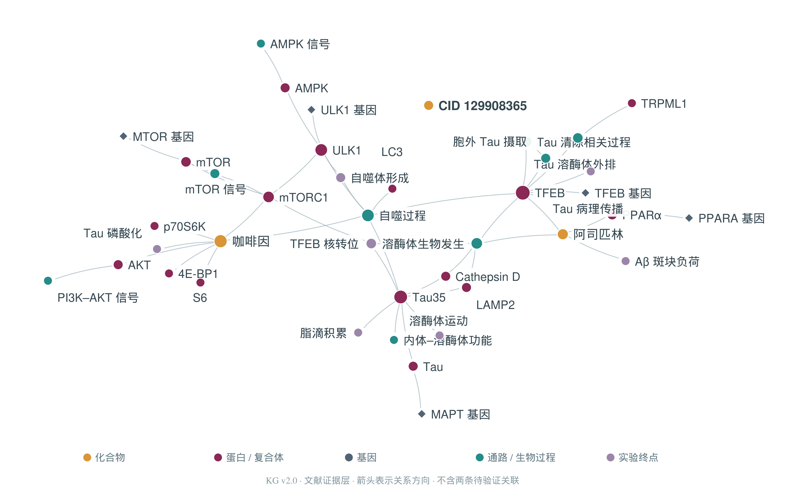
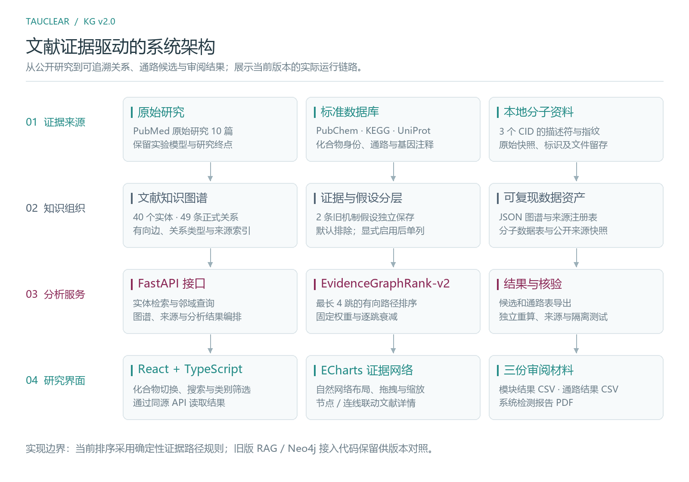
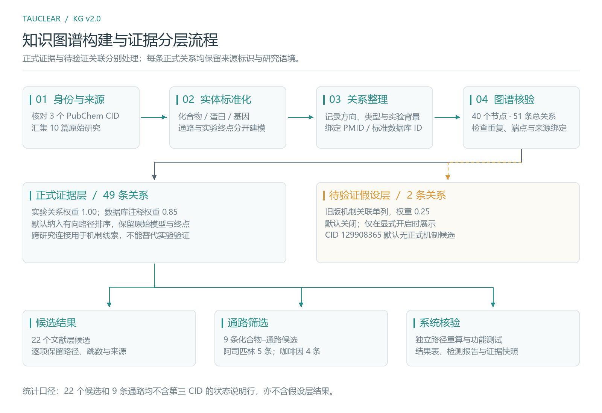
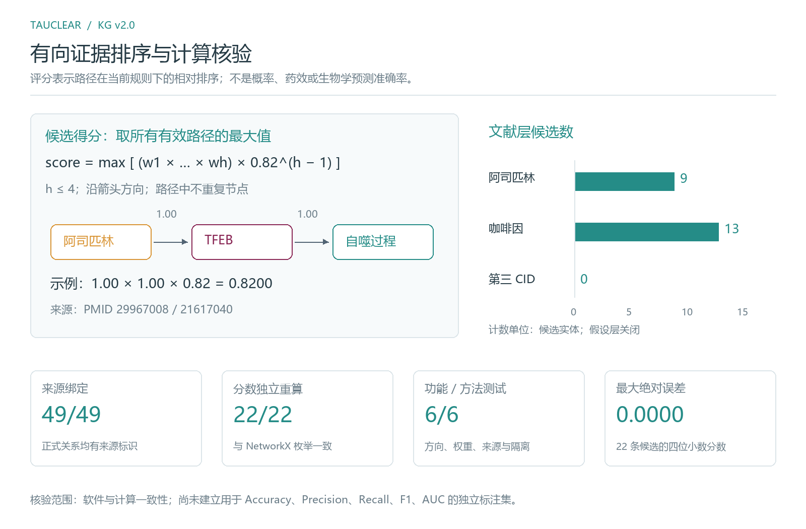

# TauClear · Tau 自噬调控文献知识图谱与通路筛选

**KG v2.0 · 可追溯文献关系 · 有向证据排序 · 可复现计算**

TauClear 将化合物、蛋白、基因、通路与实验终点组织为有向知识图谱，面向 Tau 自噬与溶酶体调控研究提供实体检索、文献追溯和通路候选筛选。当前图谱整理了 **10 篇原始研究、40 个实体、49 条正式关系**，另有 **2 条待验证关联**独立保存在假设层。

[新版源码](https://github.com/echenglight/-TauClrar-rag-kg-tau-/tree/v2.0.0) · [上一版源码](https://github.com/echenglight/-TauClrar-rag-kg-tau-/tree/v1.0.0-legacy) · [新版 ZIP](https://github.com/echenglight/-TauClrar-rag-kg-tau-/archive/refs/tags/v2.0.0.zip) · [更新记录](CHANGELOG.md) · [三份审阅材料](审阅材料/)

## 研究网络



图 1. 正式证据层的自然网络布局。颜色区分实体类型，菱形表示基因，箭头表示关系方向。交互界面支持缩放、拖拽、类别筛选和关系来源查询；待验证关联默认隐藏。2024、2025 年 Tau35 研究按其各自的实验模型与终点纳入图谱。

## 系统架构



图 2. 公开来源、本地知识资产、分析服务与研究界面的运行链路。前端采用 React、TypeScript 和 ECharts，后端采用 FastAPI；当前图谱由本地 JSON 加载，前端生产构建由后端同源提供。运行新版无需配置 Neo4j 或问答模型。

## 从研究证据到通路候选



图 3. 化合物身份核对、实体标准化、关系整理与图谱核验流程。正式关系逐条绑定 PMID 或标准数据库标识，并记录实验背景；旧版中未形成可追溯证据链的机制关联进入假设层，默认不参与正式排序。

## 排序方法与核验



图 4. 固定规则的有向证据路径评分及当前核验结果。对化合物出发、最长四跳且不重复节点的路径，取边权乘积与逐跳衰减之积的最大值：

```text
score(target) = max_path [ product(edge_weight) × 0.82^(hops − 1) ]
实验关系：1.00    数据库注释：0.85    待验证关联：0.25（默认排除）
```

当前方法名称为 **EvidenceGraphRank-v2**。兼容接口与结果文件保留 GNN 命名，但当前实现为确定性的证据路径排序，尚未训练图神经网络。分数用于比较候选路径，不表示药效、作用方向、概率或统计显著性；跨研究的多跳连接用于形成机制线索。

| 化合物 | PubChem CID | 正式层候选实体 | 化合物–通路候选 |
| --- | --- | ---: | ---: |
| 阿司匹林 | 2244 | 9 | 5 |
| 咖啡因 | 2519 | 13 | 4 |
| 第三化合物 | 129908365 | 0 | 0 |

CID 129908365 的化学身份已核对，当前正式文献层未建立机制路径；开启假设层后可另行查看待验证候选。结果表中保留该 CID 的状态说明行，表内候选计数不包括状态行。

软件核验包括：6 项功能与方法测试通过，49/49 条正式关系绑定来源，22/22 个候选分数与独立 NetworkX 路径枚举结果一致，四位小数分数的最大绝对误差为 0.0000。这些是软件与计算一致性指标；Accuracy、Precision、Recall、F1、AUC 尚未经过独立生物学效能评估。详见 [核验记录](evidence/evaluation.json) 与 [测试源码](tests/test_literature_graph.py)。

## 快速运行

Windows 安装 Python 3.10+ 后，双击 **`运行新版.bat`**，打开 `http://127.0.0.1:8086/`。启动脚本首次创建本地 `.venv` 并安装后端依赖；仓库包含前端生产构建，查看系统无需先安装 Node。

也可在项目根目录手动启动：

```powershell
python -m venv .venv
.\.venv\Scripts\python.exe -m pip install -r backend/requirements.txt
.\.venv\Scripts\python.exe -m uvicorn app.main:app --app-dir backend --host 127.0.0.1 --port 8086
```

Linux / macOS 使用 `.venv/bin/python` 替换上述 Python 路径。界面与 API 使用同一端口；[健康检查](http://127.0.0.1:8086/api/health)与 [API 文档](http://127.0.0.1:8086/docs)在服务启动后可用。

前端开发需 Node 18+ 与 pnpm：

```powershell
cd frontend
pnpm install --frozen-lockfile
pnpm run build
```

`frontend/.env.example` 默认使用同源 API。单独运行前端开发服务器时，可将 API 地址写入本地 `.env` 的 `VITE_API_BASE_URL`；本地环境文件不进入版本库。

## 计算与科研图复现

在项目根目录执行：

```powershell
.\.venv\Scripts\python.exe -m pip install -r requirements-analysis.txt
.\.venv\Scripts\python.exe scripts/build_literature_kg.py
.\.venv\Scripts\python.exe -m unittest discover -s tests -v
.\.venv\Scripts\python.exe scripts/evaluate_and_export.py
.\.venv\Scripts\python.exe scripts/render_kg_figure.py
.\.venv\Scripts\python.exe scripts/render_project_figures.py
```

新绘制的三张说明图均保留 **SVG 矢量文件、PNG 图片和绘制脚本**。图中计数由图谱和核验记录读取；中文绘图使用 Microsoft YaHei，或系统中的 Noto Sans CJK / PingFang 字体。

报告数据由 `scripts/prepare_review_report.py` 创建，PDF 导出逻辑位于 `scripts/export_review_pdf.py`。报告网页源码及构建位于 `reports/report-app/`，其维护与构建方法见该目录的 `AGENTS.md`。

## 主要文件

```text
backend/app/api/routes_v2.py                  图谱与分析接口
backend/app/services/literature_graph_service.py   文献图读取、检索与邻域
backend/app/services/evidence_rank_service.py      有向证据路径排序
backend/data/literature_graph.json                当前图谱与来源注册
frontend/src/LiteratureApp.tsx                    当前研究界面
frontend/src/components/EvidenceGraph.tsx         交互网络与固定文字锚点
frontend/dist/                                   可直接运行的前端构建
data/molecule/                                   分子描述符与指纹
evidence/raw/                                    公开来源快照
evidence/evaluation.json                         独立计算核验记录
scripts/                                        构图、排序、绘图与报告源码
tests/                                          自动化测试
docs/images/                                    科研图 PNG / SVG
reports/report-app/                              报告网页源码及已保存构建
审阅材料/                                       两份 CSV 与一份 PDF
```

### 审阅文件

- [系统图神经网络模块结果.csv](审阅材料/系统图神经网络模块结果.csv)：22 个正式层候选，附第三 CID 状态行；包含模型名、分数、路径、跳数和来源。
- [三个化合物通路筛选结果.csv](审阅材料/三个化合物通路筛选结果.csv)：9 条通路候选，附第三 CID 状态行；区分直接关系与多跳推断。
- [通路筛选与系统检测报告.pdf](审阅材料/通路筛选与系统检测报告.pdf)：6 页，包含图谱、筛选结果、计算方法、系统核验与参考来源。

## 版本保存

| 版本 | 内容 | 固定入口 |
| --- | --- | --- |
| v2.0.0 | 当前文献图谱、证据路径排序、新界面、筛选结果、报告及科研图 | [查看源码](https://github.com/echenglight/-TauClrar-rag-kg-tau-/tree/v2.0.0) |
| v1.0.0-legacy | 更新前原始平台，包含旧图谱、原有评分与 RAG 接入代码 | [查看源码](https://github.com/echenglight/-TauClrar-rag-kg-tau-/tree/v1.0.0-legacy) · [下载 ZIP](https://github.com/echenglight/-TauClrar-rag-kg-tau-/archive/refs/tags/v1.0.0-legacy.zip) |

`main` 展示当前版本；旧版由固定标签保存，Git 历史完整保留。已有仓库可通过 `git fetch --tags` 获取版本标签，再用 `git switch --detach v1.0.0-legacy` 查看旧版，用 `git switch main` 返回当前分支。

## 证据索引

原始研究 PMID：29967008、21081844、20838929、30108137、21617040、22343943、21258367、32366951、39009859、41399158。完整题录、来源链接及研究语境见 [来源注册表](evidence/sources.json) 和 [图谱数据](backend/data/literature_graph.json)。
