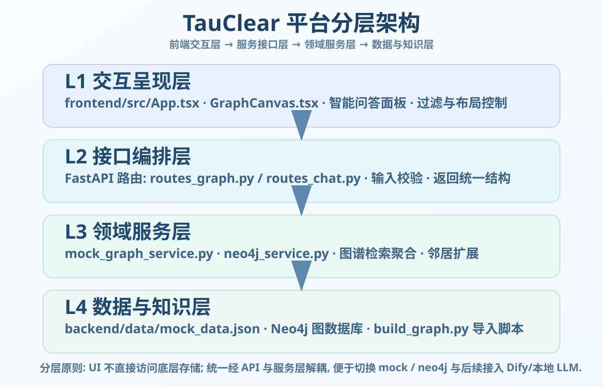
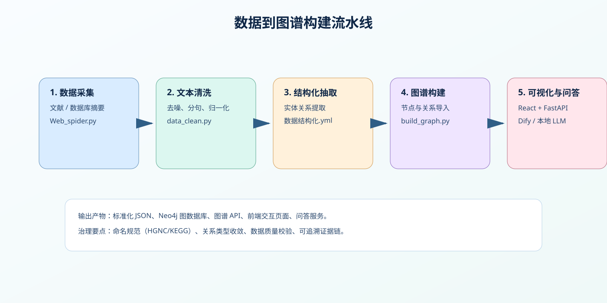
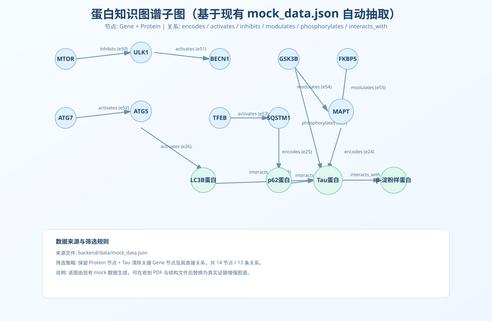

# TauClear 平台（分层架构版）

TauClear 聚焦 Tau 蛋白自噬调控通路的数据整合、知识图谱构建与智能问答。当前仓库支持 mock 数据快速演示，也支持切换 Neo4j 作为图谱后端。

## 1. 平台分层总览

系统按职责拆分为四层：交互呈现层、接口编排层、领域服务层、数据与知识层。



### 分层说明

| 层级            | 责任                              | 关键文件                                                                                   |
| --------------- | --------------------------------- | ------------------------------------------------------------------------------------------ |
| L1 交互呈现层   | 图谱可视化、筛选控制、问答交互    | `frontend/src/App.tsx`, `frontend/src/components/GraphCanvas.tsx`                          |
| L2 接口编排层   | REST 路由、参数校验、返回结构统一 | `backend/app/api/routes_graph.py`, `backend/app/api/routes_chat.py`, `backend/app/main.py` |
| L3 领域服务层   | 图谱检索/聚合、mock 与 neo4j 解耦 | `backend/app/services/mock_graph_service.py`, `backend/app/services/neo4j_service.py`      |
| L4 数据与知识层 | 图谱数据、Neo4j 存储、导入构建    | `backend/data/mock_data.json`, `backend/build_graph.py`                                    |

## 2. 模块流水线（从数据到图谱）

从数据采集到可视化与问答，建议按以下流水线执行：



### 处理阶段

1. 数据采集：收集文献、数据库摘要或实验条目。
2. 文本清洗：去噪、分句、实体归一化。
3. 结构化抽取：抽取实体及关系并标准化。
4. 图谱构建：导入 Neo4j 或生成 mock 数据。
5. 展示与问答：前端图谱交互 + 问答服务。

## 3. 智能问答模块链路

问答模块采用“检索 + 图谱查询 + LLM 生成”模式，可接 Dify 或本地 LLM。


### 关键链路

1. 输入 `question`。
2. 参数提取器识别实体与关系线索。
3. 并行执行知识检索与图谱 API 请求。
4. 聚合上下文后交给 LLM 生成回答。
5. 输出答案，并可附带证据来源。

## 4. 目录结构

```text
.
├─ backend/
│  ├─ app/
│  │  ├─ api/                # 路由层
│  │  ├─ services/           # 领域服务层
│  │  ├─ schemas/            # 数据模型定义
│  │  └─ core/               # 配置项
│  ├─ data/mock_data.json    # mock 图谱数据
│  └─ build_graph.py         # Neo4j 导入脚本
├─ frontend/
│  ├─ src/components/        # 可视化组件
│  ├─ src/api/               # 前端 API 调用
│  └─ src/hooks/             # 交互增强逻辑
├─ docs/images/              # README 配图
└─ start_platform.ps1/.bat   # 一键启动
```

## 5. 快速启动

### 一键启动（Windows）

```powershell
./start_platform.ps1
```

或双击 `start_platform.bat`。

### 手动启动

后端：

```bash
cd backend
pip install -r requirements.txt
uvicorn app.main:app --reload --host 0.0.0.0 --port 8000
```

前端：

```bash
cd frontend
npm install
npm run dev
```

访问地址：

- 前端：`http://localhost:5173`
- 后端：`http://localhost:8000`

## 6. 核心 API

- `GET /api/health`：健康检查
- `GET /api/graph/all`：全量图谱
- `GET /api/graph/search?keyword=...`：关键词搜索
- `GET /api/graph/neighbors/{node_id}`：节点邻居子图
- `GET /api/analysis/search?keyword=...`：统一输出 KG + 分子指纹 + 轻量 GNN 候选
- `GET /api/templates`：模板知识图谱列表
- `GET /api/templates/{template_id}`：模板知识图谱详情（含可视化图数据）
- `POST /api/chat/ask`：问答接口（可接 Dify/本地 LLM）

## 7. Neo4j 导入

在 `backend/` 目录执行：

```bash
python build_graph.py --uri bolt://localhost:7687 --user neo4j --password your_password --data data/mock_data.json --wipe
```

导入后会创建 `Entity` 主标签，并按类型细分（Gene/Compound/Pathway/Disease/Protein）。

## 8. 数据源切换

编辑 `backend/.env`（可由 `.env.example` 复制）：

- `GRAPH_SOURCE=mock`：使用本地 mock 数据
- `GRAPH_SOURCE=neo4j`：使用 Neo4j 查询

## 9. 后续可扩展项

1. 问答返回中增加证据出处与置信度分数。
2. 增加图谱路径推理视图（起点-终点最短路径/多跳关联）。
3. 引入鉴权、审计日志与实验记录对照。

## 10. 蛋白知识图谱图片（基于现有数据生成）

当前图片由仓库现有 `backend/data/mock_data.json` 抽取 Protein + 关键 Gene 子图生成，可直接用于阶段汇报：



### 你当前阶段可完成的工作

1. 平台搭建与联调（前端交互、后端 API、图谱服务切换）。
2. 图谱结构模板与字段规范准备（节点类型、关系类型、证据字段）。
3. 问答链路预留（Dify 或本地 LLM 接口对接位）。

### 正式蛋白图谱生成需要对方提供

1. PDF 文献数据（批量原文或摘要）。
2. 蛋白结构数据（PDB 或 mmCIF）。
3. 可选的命名标准映射（UniProt/HGNC/KEGG/MeSH）。

收到上述输入后，可在当前子图基础上补充文献证据与结构注释，升级为“真实实体关系图”，并在前端展示可检索、可追溯证据的蛋白知识图谱。
